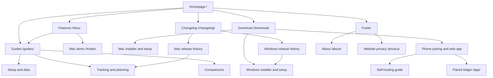

# PocketLeft website architecture

Architecture and implementation · November 22, 2026

Implemented in the local worktree and verified with a production build. The live observations below describe the baseline. See the [SEO and AI search audit](docs/SITE-SEO-AUDIT.md) for the verification results.

Keep the homepage focused on what Pocket does and how to try it. Add one permanent download page that explains the Mac app, the Windows preview, and the paired web app. Use Guides for setup and recurring tasks, and Changelog for release history.

The site serves prospective Mac and Windows users, people arriving from search, and existing users looking for setup, recovery, or updates. Prioritize downloads, then product understanding, then self-service support.

## What the live site showed

| Finding | Impact |
| --- | --- |
| The homepage header mixes five jumps down the homepage with links to Guides and Changelog. Download details start about 8,100 pixels down on a 1280 × 900 Mac viewport and 10,100 pixels down on a 390 × 844 phone viewport. | The hero download is easy to reach on a recognized desktop. A phone visitor choosing Desktop downloads jumps about twelve viewport heights down. |
| The Windows hero offers the Windows installer. Its “Take the tour” link opens a Mac video and screenshots, and the announcement highlights the Mac release. | Visitors can download the right file while reading about a different platform. The Windows release history already has its own section and can provide the correct destination. |
| A Mac visitor opening `/#windows` has no visible Windows section after platform detection. | The shared link depends on the visitor’s device. |
| Guides shows ten articles in one list. The Mac menu bar guide still says to quit Pocket to hide the balance. | Setup, troubleshooting, and comparison guides compete for attention. The screen-sharing instructions lag behind the app. |
| All 15 sitemap pages returned HTTP 200. All 159 unique fragment references in the audited server-rendered HTML resolved, and every indexed page had an inbound link. | The existing URL and link structure is a strong base. The main work is clarifying each destination and making platform links reliable after the page loads. |

The viewport measurements are layout snapshots from Chromium with platform settings for Mac, Windows, and iPhone. They measure page length and element positions. Traffic, click-through, and download conversion were outside this audit. [Homepage](https://pocketleft.app/) · [Guides](https://pocketleft.app/guides/) · [Changelog](https://pocketleft.app/changelog/) · [Menu bar guide](https://pocketleft.app/guides/menu-bar-balance/#screen-sharing)

## Page hierarchy

The new page is `/download/`. Guide groups are sections on the existing index. Existing article URLs stay flat.

```text
PocketLeft (/)
├── Features (/#tour)
│   ├── Mac demo (/#video)
│   ├── Plan and forecast (/#plan)
│   ├── Subscriptions (/#subscriptions)
│   └── Data storage and sync (/#private)
├── Download (/download/)                       new
│   ├── Mac (/download/#mac)
│   ├── Windows preview (/download/#windows)
│   └── Web app and pairing (/download/#web)
├── Guides (/guides/)
│   ├── Setup and data (/guides/#setup)
│   │   ├── /guides/getting-started/
│   │   ├── /guides/back-up-your-data/
│   │   └── /guides/self-hosting/
│   ├── Tracking and planning (/guides/#tracking)
│   │   ├── /guides/menu-bar-balance/
│   │   ├── /guides/quick-add-spending/
│   │   ├── /guides/track-subscriptions/
│   │   ├── /guides/expected-income/
│   │   └── /guides/freelance-income/
│   └── Comparisons (/guides/#comparisons)
│       ├── /guides/manual-vs-bank-sync/
│       └── /guides/mac-menu-bar-money-apps/
├── Changelog (/changelog/)
│   ├── Mac (/changelog/#mac)
│   └── Windows (/changelog/#windows)
├── About (/about/)
└── Website privacy (/privacy/)

Web app (/app/)              Paired ledger entry point · noindex
Shared homepage (/share/)    Existing share link · noindex · canonical /
Former Mac URL (/mac/)       Existing permanent redirect to /
```

## Visual sitemap



## URL map

| Page | URL | Parent | Navigation location | Priority |
| --- | --- | --- | --- | --- |
| Homepage | `/` | — | Logo | High |
| Features and demo | `/#tour`, `/#video` | Home | Header Features, hero, footer | High |
| Download and install | `/download/` | Home | Header CTA, hero secondary link, footer | High |
| Mac | `/download/#mac` | Download | Platform links and Mac releases | High |
| Windows preview | `/download/#windows` | Download | Windows hero, download page, Windows releases | High |
| Phone and web | `/download/#web`, `/app/` | Download | Phone hero and footer | High |
| Guides and guide articles | `/guides/`, `/guides/<slug>/` | Home, Guides | Header, footer, feature and release context | High |
| Release history | `/changelog/#mac`, `/changelog/#windows` | Changelog | Header, platform announcements, download panels | Medium |
| About and policy | `/about/`, `/privacy/` | Home | Footer | Low |

Use the existing trailing slash policy. Preserve homepage fragments `#tour`, `#video`, `#subscriptions`, `#plan`, `#waiting`, `#quick-add`, `#categories`, `#private`, `#guides`, `#faq`, `#downloads`, and `#windows` when content moves within the page. Keep the last two as visible, compact shortcuts to installation details, with a stable Windows shortcut across devices. Retain merged release aliases such as `/changelog/#v1-5-4` and `/changelog/#v1-2-0`. Add `/download/` to the sitemap when it launches.

## Navigation and page layout

**Header** · Features → Guides → Changelog → **Download**. The logo returns home. Use the same order on desktop and in the mobile menu. Features jumps to the homepage tour, and the rightmost Download button opens the platform chooser. Recognized desktop visitors still get the direct installer as the primary button in the hero.

| Visitor | Primary homepage action | Next action |
| --- | --- | --- |
| Mac | Download for Mac | Take the Mac tour, with a visible link to all download options |
| Windows | Download for Windows | See the Windows preview, with a link to Windows release notes |
| Phone or unknown platform | Try the sample ledger | View desktop downloads or open an existing synced ledger. The download page explains pairing. |

**Homepage reading order**

1. **Hero.** Explain manual tracking and the balance at a glance. Show the right primary action and one secondary action. Link the release announcement to the matching platform’s notes.
2. **Product tour.** Keep the existing video at `/#video` and the tabbed screenshots inside `/#tour`. Use the tour as the main place to see the product.
3. **Three core workflows.** Show how to record an expense, how to see what’s available before payday, and how to track renewals. Link each to the relevant guide. Fold the current standalone waits-for-payment and spending-comparison explanations into this section while retaining their anchors.
4. **Privacy, help, and downloads.** Summarize local storage and optional sync, surface getting started, and keep the purchase and setup questions easy to scan. Follow with a compact download row that links to the platform chooser.

**Download page.** Show both desktop installers regardless of the visitor’s operating system. Platform detection can highlight a card. Give each card version, requirements, the matching installer, concise installation steps, and a release history link. Identify Windows as a preview and explain the unsigned installer there. Add the web app as a third option with the pairing guide. Use the same version and installer constants that drive the homepage.

**Footer.** Group Features, Download, and the web app under Product. Group Guides, pairing, and Report a bug under Help. Group About, Changelog, and GitHub under Project. Keep Website privacy and Analytics preferences in the legal row.

**Guide and release navigation.** Keep the existing guide breadcrumbs and align their text with the structured breadcrumb. Group the index with a prominent Get started link and the three section anchors. Keep the Mac and Windows release jump links and version sidebars. The new download page is one level from home and can use the shared header.

## Internal links and rollout

| Order | Work | Verification |
| --- | --- | --- |
| 1 | Add the platform chooser, simplify the header, and route Windows announcements and tour links to Windows content. | Walk through direct Mac and Windows installs, viewing the other installer from each desktop, and the phone pairing path. Verify the installer links and platform labels in the browser. |
| 2 | Consolidate homepage demos. Add one contextual guide link to each core workflow. Group the Guides index and correct the screen-sharing instructions. | Check keyboard navigation, desktop and mobile widths, and every existing homepage fragment. Confirm the video still plays through the original link. |
| 3 | Link setup and release notes to workflows. Point Mac 1.5.5 to quick-add and screen-sharing help, then add the payday steps to the existing planning guide. Point Windows releases to the Windows setup card. | Re-run the public URL and fragment audit, including aliases and both platform release sections. Confirm each guide still has an inbound link from the index and a relevant product or guide page. |

Treat this as a website update. Compare the existing consented download-click event by platform before and after the rollout when sufficient data is available. Pair that with short sessions asking visitors to find the correct installer, locate the Mac demo, and open the setup instructions for their device.
